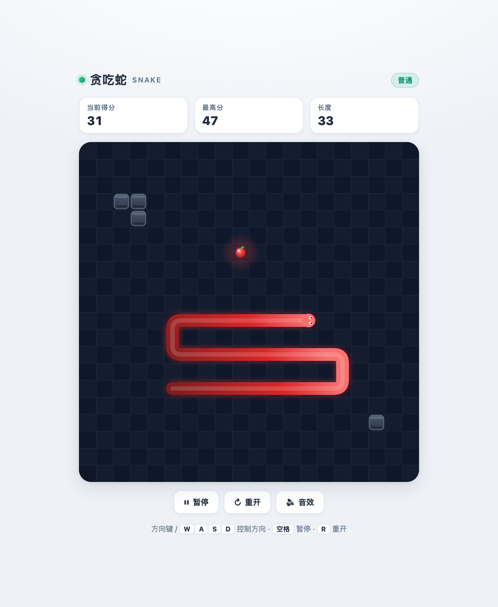
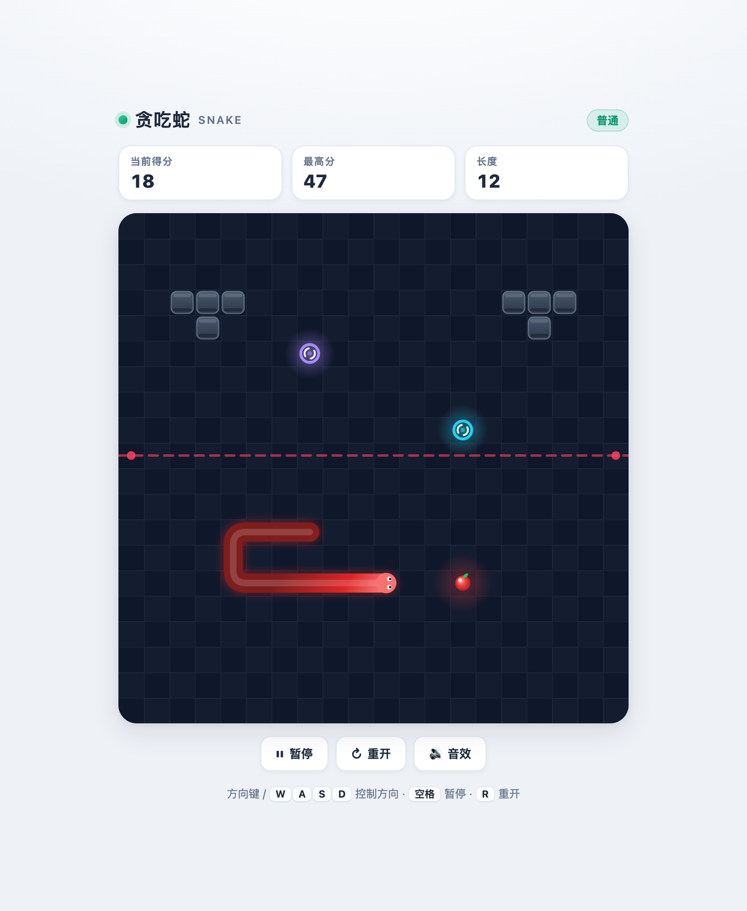

# 🐍 Snake

> A **single-file, zero-dependency** HTML5 Snake game. No build step, no npm packages — just double-click `index.html` and play.

<p>
  <a href="https://cola-hii-49362.github.io/snake-game/"><b>🎮 Play online</b></a>
  &nbsp;·&nbsp;
  <a href="https://github.com/Cola-hii-49362/snake-game">📦 Source</a>
</p>



> ℹ️ The in-game UI text is in Chinese. See [Changing the UI language](#changing-the-ui-language) if you'd like to translate it.

---

## Table of contents

- [What is this](#what-is-this)
- [Mini-game branch](#mini-game-branch)
- [Quick start](#quick-start)
- [Controls](#controls)
- [How to play](#how-to-play)
- [Difficulty](#difficulty)
- [Features](#features)
- [Under the hood](#under-the-hood)
- [Project structure](#project-structure)
- [Customization guide](#customization-guide)
- [Deployment & updates](#deployment--updates)
- [Browser support](#browser-support)
- [License](#license)

---

## What is this

A Snake game written in vanilla HTML5 Canvas. The entire thing — markup, styles, game logic, and sound — lives in **one `index.html` file** of roughly 1,300 lines.

It was built around three goals:

- **Open it and play.** No environment to install, no compilation, no network access required (the sound effects are synthesized at runtime, so there are no audio files).
- **It has to feel good.** The snake glides smoothly instead of hopping cell by cell.
- **It works on phones.** Touch swipes and an on-screen D-pad are supported.

---

## Mini-game branch

This branch — `feature/minigames` — layers three extra hazards on top of the classic game. `main` stays classic; this is the "chaos mode" experiment.



| Element | Behaviour |
| --- | --- |
| 🧱 **Obstacles** | Static blocks scattered across the board. Hitting one ends the game. The count scales with difficulty: 6 / 8 / 10. |
| 🌀 **Portals** | A linked pair (purple ↔ cyan). Enter one and the snake comes out of the other, keeping its direction. They **activate once the snake reaches 8 segments**, announced with a toast. |
| 🔴 **Laser** | A full-width beam that telegraphs itself with a dashed line and edge emitters for **1.4 s**, then fires for **0.52 s**. If the snake's **head** is on the beam line while it fires, the game ends. Lasers start appearing after you score **8 points**, one at a time, with a 1.6 s gap between them. |

Design notes:

- **Only the head is checked against the laser.** The beam passes harmlessly through the body — otherwise a long snake could be killed by a beam it has no way to clear in time.
- **Lasers never spawn within 3 cells of the snake's head**, so there is always room to react during the warning phase.
- **Obstacles and portals never overlap**, and food never spawns on either. The area around the starting snake is kept clear.
- Portals teleport the head only; the renderer splits the body at that moment so the snake doesn't draw a line across the whole board.
- **Exiting onto your own body is allowed.** Portals are placed on empty cells, but the snake's body can drift over an exit later. Landing on yourself this way does **not** kill you — the snake briefly overlaps and untangles as it moves on. Treating it as a self-collision would punish the player for something they cannot control.

All the tuning values live in one place:

```js
const FEATURES = {
  obstacles:      { easy: 6, normal: 8, hard: 10 },
  portalAtLength: 8,
  laserFromScore: 8,
  laserWarnMs:    1400,
  laserFireMs:    520,
  laserGapMs:     1600,
  laserSafeDist:  3
};
```

---

## Quick start

### Option 1: Play online (easiest)

Open <https://cola-hii-49362.github.io/snake-game/>

### Option 2: Run it locally

Download `index.html` and double-click it. Or press `Cmd/Ctrl + O` in your browser and select the file.

### Option 3: Serve it locally (optional)

If you're editing the code and want to avoid browser caching, spin up a local server:

```bash
cd snake-game
python3 -m http.server 8000
# then visit http://localhost:8000
```

---

## Controls

| Action | Keyboard | Touch / mobile |
| --- | --- | --- |
| Move | `↑` `↓` `←` `→` or `W` `A` `S` `D` | Swipe on the board, or tap the D-pad below it |
| Pause / resume | `Space` | Tap the pause button |
| Restart | `R` or `Enter` | Tap the restart button |
| Toggle sound | Click the sound button in the toolbar | Same |

A few details that matter for how it feels:

- **Input is buffered.** Quick consecutive turns aren't dropped (up to two moves are queued), but the buffer is short enough that a stray keypress won't send you somewhere you didn't intend.
- **No 180° reversals.** Pressing left while moving right does nothing — you can't instantly kill yourself.
- **Switching tabs auto-pauses**, so you won't come back to find you've crashed into a wall.

---

## How to play

1. The snake moves forward continuously. Eat the **red fruit** to score.
2. Each fruit **grows the snake by one segment** and awards **+1 point**.
3. **The more you eat, the faster it gets** — every 5 points bumps the speed up one level (with a floor, so it never becomes unplayable).
4. The game ends when:
   - the snake's head **hits a wall**, or
   - the snake's head **hits its own body**.
5. Your best score is saved locally in the browser (`localStorage`), so it survives closing the page. Beating it triggers a "New record!" badge.

> 🧨 **On this branch there are extra ways to die** — obstacles and lasers. See [Mini-game branch](#mini-game-branch) for the full rules.

> 💡 Tip: hugging the walls leaves you more open space. Once the snake is long, try to circle rather than zig-zag back and forth, or you'll trap yourself.

---

## Difficulty

Three difficulty levels are available on the start screen. They differ only in **speed parameters**:

| Difficulty | Starting speed | Top speed | Speed-up per level |
| --- | --- | --- | --- |
| Easy | 175 ms / step | 95 ms / step | −4 ms |
| Normal | 140 ms / step | 70 ms / step | −5 ms |
| Hard | 105 ms / step | 55 ms / step | −4 ms |

(Smaller numbers mean the snake moves faster. One level is gained every 5 points.)

---

## Features

- ✅ Single file, zero dependencies, works offline
- ✅ Interpolated rendering for smooth, fluid snake movement
- ✅ Three control schemes: keyboard, touch swipe, on-screen D-pad
- ✅ Three difficulty levels with automatic speed-up
- ✅ Best score persisted locally
- ✅ Sound effects synthesized with WebAudio, mutable with one click
- ✅ Pause / restart / auto-pause when the tab loses focus
- ✅ Responsive layout that fits phone portrait and desktop widescreen
- ✅ HiDPI-aware rendering (`devicePixelRatio`)

---

## Under the hood

### Architecture

The code is split into three layers, all inside the `<script>` block at the bottom of `index.html`:

| Layer | Responsibility | Key functions |
| --- | --- | --- |
| State | Holds the game data | the `game` object |
| Logic | Advances the game on a fixed timestep | `step()` / `spawnFood()` / `gameOver()` |
| Rendering | Draws the frame | `draw()` / `drawSnake()` / `drawFood()` |

### Implementation notes

**1. Fixed timestep + interpolated rendering**

Game logic can't be tied to the display refresh rate, or a 60 Hz and a 120 Hz monitor would produce different snake speeds. So it uses an accumulator: logic advances on a fixed `stepMs`, while rendering derives an `alpha` (0–1) from the leftover time and interpolates each segment's position between the previous step and the current one.

```js
game.acc += dt;
while (game.acc >= game.stepMs) { game.acc -= game.stepMs; step(); }
game.alpha = game.acc / game.stepMs;   // handed to the renderer for smoothing
```

This is why the snake glides rather than hopping between cells.

**2. Smooth snake body**

Rather than drawing a square per segment, the interpolated coordinates are joined into a single path, corners are smoothed with **quadratic Bézier curves**, and the path is stroked with rounded caps:

```js
ctx.lineCap = "round";
ctx.lineJoin = "round";
ctx.lineWidth = cell * 0.74;
```

A `shadowBlur` pass adds the outer glow, and a translucent white stroke adds a highlight — which gives the body a rounded, three-dimensional look. The head is drawn as its own circle with two eyes oriented along the current direction.

**3. Direction input queue**

Direction keys must not write to `dir` directly; otherwise two presses within a single frame could bypass the reversal check. Inputs go into a queue and exactly one is consumed per step:

```js
if (name === last) return;              // same direction, ignore
if (name === OPPOSITE[last]) return;    // no 180° reversal
if (game.queue.length >= 2) return;     // buffer at most two moves
```

**4. The tricky edge case in collision detection**

When checking whether the snake hit itself, there's an easy mistake to make: **if the snake isn't eating this step, the tail vacates its cell at the same time**, so moving into the current tail cell is legal.

```js
const limit = willEat ? game.snake.length : game.snake.length - 1;
```

**5. Sound**

There are no audio files. Everything is synthesized live with WebAudio `OscillatorNode`s — eating is two rising blips, and game over is three descending tones.

**6. Persistence**

| Data | Storage key |
| --- | --- |
| Best score | `snake_best_v1` |
| Sound on/off | `snake_sound_v1` |

---

## Project structure

```
snake-game/
├── index.html      # The whole game (markup + styles + logic in one file)
├── docs/
│   ├── preview.png            # Classic screenshot used in this README
│   └── preview-minigames.png  # Mini-game branch screenshot
├── .gitignore      # Ignores OS files, editor config, local AI assistant data
└── README.md       # The document you're reading
```

> That's it. No `node_modules`, no build artifacts.

---

## Customization guide

Want to change something? Here are the most common tweaks, all inside `index.html`.

### Board size

```js
const COLS = 20;
const ROWS = 20;
```

⚠️ Note: the board container is locked to a square by the CSS `aspect-ratio: 1/1`. If you make `COLS` and `ROWS` unequal, the rendering will stretch. To support a rectangular board, update the `aspect-ratio` on `.stage` as well.

### Speed and difficulty

```js
const DIFFICULTIES = {
  easy:   { label: "轻松", base: 175, min: 95, step: 4 },
  normal: { label: "普通", base: 140, min: 70, step: 5 },
  hard:   { label: "挑战", base: 105, min: 55, step: 4 }
};
```

- `base` — starting milliseconds per step (smaller is faster)
- `min` — speed ceiling (the fastest milliseconds per step)
- `step` — milliseconds removed per level gained

To change how many points make a level, look at `Math.floor(game.score / 5)` inside `updateSpeed()` and change the `5`.

### Colors

The main palette lives in the `:root` block at the top of the CSS:

```css
:root{
  --brand: #10b981;   /* primary green */
  --accent: #ef4444;  /* fruit red */
  --board: #0f172a;   /* board background */
}
```

The snake and fruit gradients are in the JS: search for `#5eead4` / `#34d399` / `#0d9488` for the snake, and `#fca5a5` / `#ef4444` / `#b91c1c` for the fruit.

### Starting length

In `resetGame()`:

```js
game.snake = [
  { x: 6, y: mid },
  { x: 5, y: mid },
  { x: 4, y: mid }
];
```

Add more entries for a longer starting snake.

### Changing the UI language

All user-facing strings are plain text in the HTML body — no i18n layer. To translate the interface:

1. **Static text** — edit it directly in the markup. This covers the title, the three scoreboard labels (`当前得分` / `最高分` / `长度`), the toolbar buttons (`暂停` / `重开` / `音效`), the hint line, and the overlay copy for start / pause / game over.
2. **Difficulty labels** — the buttons carry `data-diff="easy|normal|hard"`, while their visible names come from two places: the button text in the HTML, and the `label` field in the `DIFFICULTIES` object (which feeds the badge next to the title). Update both.
3. **Dynamic strings** — a couple of labels are set from JS: the sound button renders `音效` / `静音` in `renderSoundBtn()`, and the "New record!" badge is the `#badgeNew` element.

---

## Deployment & updates

This repo has **GitHub Pages** enabled; the root of the `main` branch deploys automatically.

Live URL: <https://cola-hii-49362.github.io/snake-game/>

Updating is two commands, and Pages redeploys about 30 seconds later:

```bash
git add -A
git commit -m "your message"
git push
```

> If you still see the old version after pushing, hard-refresh with `Cmd/Ctrl + Shift + R` — Pages caches aggressively.

---

## Browser support

Requires a modern browser with Canvas 2D, `localStorage`, and `requestAnimationFrame`:

| Browser | Status |
| --- | --- |
| Chrome / Edge | ✅ |
| Safari (incl. iOS) | ✅ |
| Firefox | ✅ |

Sound depends on WebAudio. In the rare browser that lacks it, audio is **skipped silently** and gameplay is unaffected.

---

## License

No license has been added yet. If you intend to open-source this properly, consider adding one (MIT, for example).
